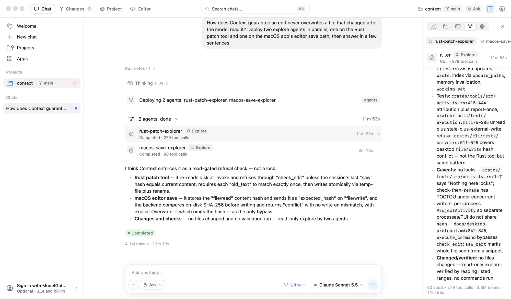
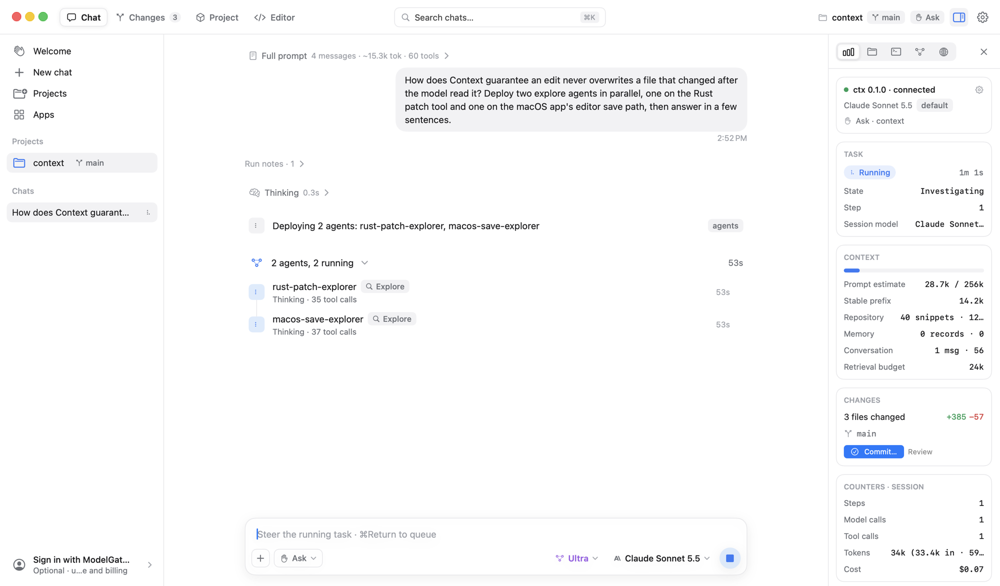
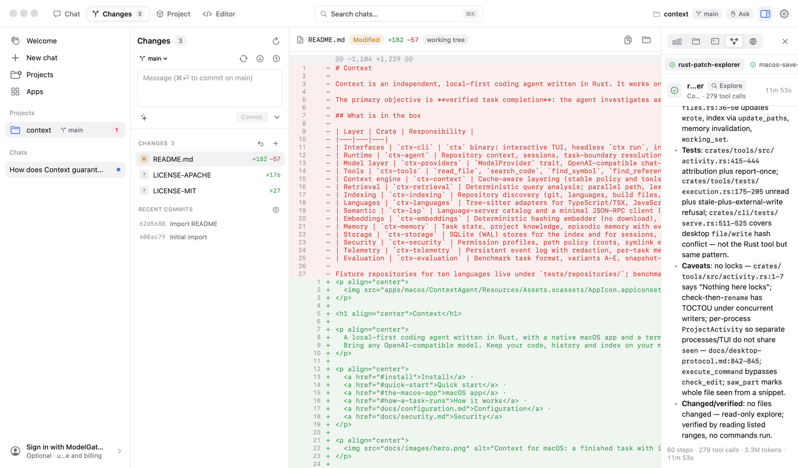
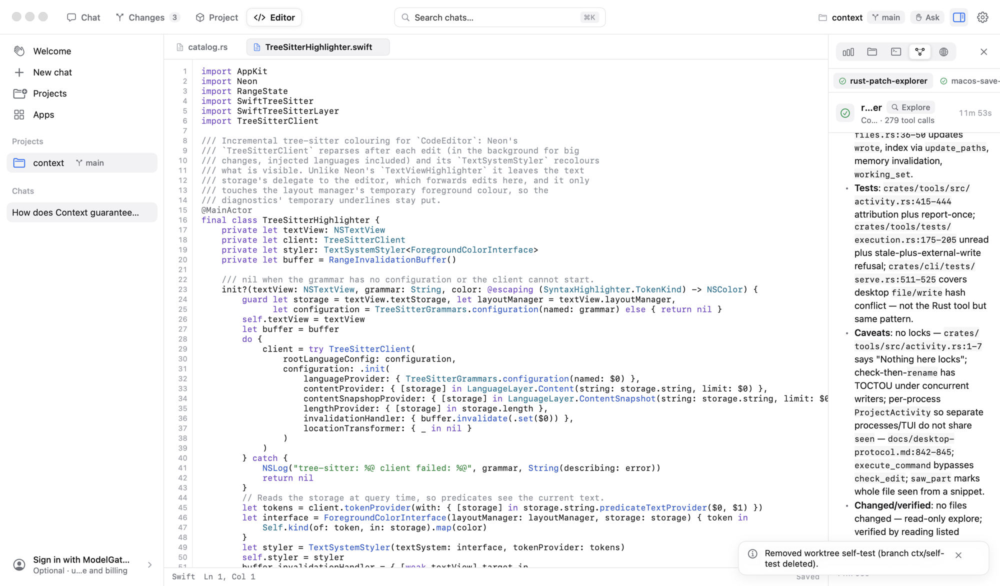
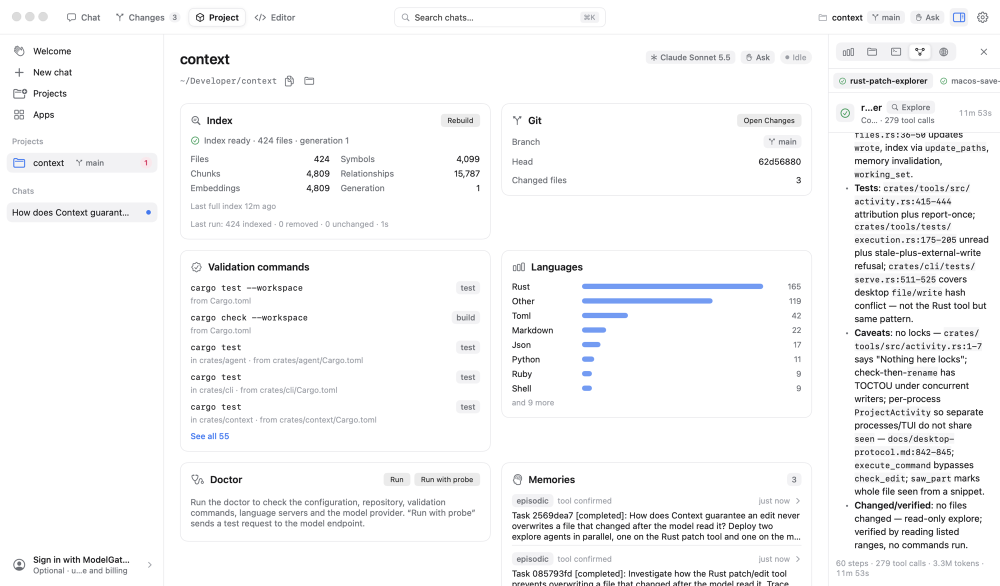
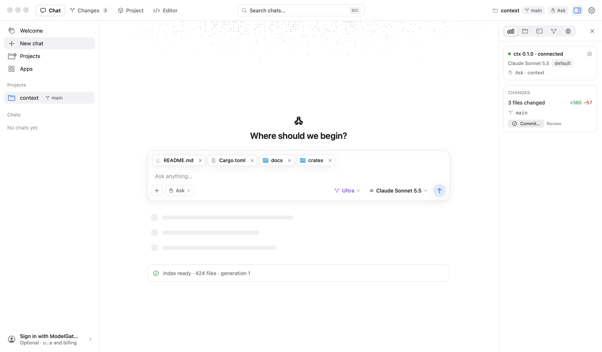
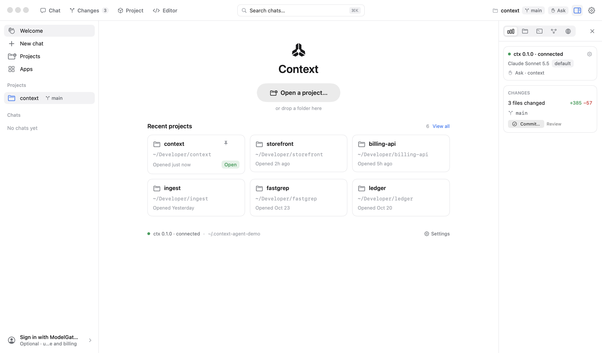

<p align="center">
  
</p>

<h1 align="center">Context</h1>

<p align="center">
  A local-first coding agent written in Rust, with a native macOS app and a terminal UI.<br>
  Bring any OpenAI-compatible model. Keep your code, history and index on your machine.
</p>

<p align="center">
  <a href="#install">Install</a> ·
  <a href="#quick-start">Quick start</a> ·
  <a href="#the-macos-app">macOS app</a> ·
  <a href="#how-a-task-runs">How it works</a> ·
  <a href="docs/configuration.md">Configuration</a> ·
  <a href="docs/security.md">Security</a>
</p>

<p align="center">
  
</p>

---

Context works on real repositories through its own tool loop. Its goal is **verified task completion**: it investigates as much as it needs to, checks the exact current source before every edit, runs the project's own validation, recovers from failures within a bounded budget, and reports honestly what it changed and what it could not verify.

What makes it different from a chat window with tools bolted on:

- **It knows the repository before the model does.** A Tree-sitter index (ten languages), lexical search (SQLite FTS5/BM25), a symbol graph, embeddings and an episodic memory are fused per request, verified against the working tree, and packed into a token budget chosen for the kind of task.
- **Context is assembled, not accumulated.** Stable policy and tool schemas come first so provider caches hit; repository content is fenced as untrusted data; old turns are compacted into checkpoints. `ctx context explain` shows exactly what the model saw and why.
- **Edits are safe by construction.** Patches carry the hash of the text they were written against and are rejected if the file changed underneath. Every file touched, command run and test result is recorded independently of what the model says it did.
- **Permissions are explicit.** Three profiles (ask, workspace-autonomous, bypass), a conservative command classifier that looks through pipes, wrappers and substitutions, path policy with symlink checks, and credential redaction everywhere.
- **It scales up when the task does.** At the Ultra effort tier the model can deploy bounded sub-agents (read-only explorers or full implementers under the same permissions) that work in parallel and report back.
- **Any endpoint.** OpenAI, a gateway, a self-hosted server or a local runtime: `ctx doctor --probe` verifies what the endpoint actually supports (tool calling, streaming, usage, parallel calls) and the runtime only relies on what was verified.

## Screenshots

<table>
  <tr>
    <td width="50%"></td>
    <td width="50%"></td>
  </tr>
  <tr>
    <td><b>Live runs.</b> Sub-agents working in parallel, streaming replies, grouped tool calls and inline approvals, with the run's context budget, changes and cost in the inspector.</td>
    <td><b>Changes.</b> Review every diff the agent made, stage, commit, branch or open a pull request without leaving the app.</td>
  </tr>
  <tr>
    <td></td>
    <td></td>
  </tr>
  <tr>
    <td><b>Editor.</b> A built-in editor with Tree-sitter highlighting plus completions, hover, go-to-definition and diagnostics from the project's language servers.</td>
    <td><b>Project.</b> What Context knows about the repository: index health, languages, detected validation commands and memories.</td>
  </tr>
  <tr>
    <td></td>
    <td></td>
  </tr>
  <tr>
    <td><b>Start anywhere.</b> Attach files, folders and images, pick the effort tier and any model your endpoint serves.</td>
    <td><b>Projects.</b> Open any folder, run parallel sessions in git worktrees, and pick up history from the terminal UI.</td>
  </tr>
</table>

## Install

### macOS app

Download the latest signed and notarized `Context-<version>.dmg` from [Releases](../../releases), open it and drag **Context** to Applications. The app bundles the `ctx` backend, so nothing else is needed. Requires macOS 26 (Tahoe) or later on Apple silicon.

The app keeps itself up to date: it checks for a new release once a day, downloads it in the background and installs it, `ctx` included, the next time you quit. **Context → Check for Updates…** checks right away, and Settings → General → Updates turns the automatic parts off.

### Windows

Download `Context_<version>_x64-setup.exe` (or the `.msi`) from [Releases](../../releases). The desktop app bundles `ctx.exe`; the CLI runs natively in Windows Terminal, PowerShell or Git Bash, without WSL. Install [Git for Windows](https://git-scm.com/download/win) as well: the agent runs its commands in its bash when it is there.

The Windows app keeps itself up to date the same way: it checks for a new release once a day, downloads it in the background and installs it, `ctx.exe` included, the next time you quit. **Check for updates…** in the command palette (Ctrl+K) checks right away, and Settings → General → Updates turns the automatic parts off. An update uses the installer you started with, so the per-machine `.msi` asks for administrator approval each time. Copies installed from 0.1.2 or earlier have no updater yet: install a later release over them once.

Details, including building from source: [docs/windows.md](docs/windows.md).

### From source

You need a stable Rust toolchain (1.85+). The macOS app additionally needs Xcode 26; the cross-platform desktop app in `apps/desktop` (Tauri) needs Node.js 22 ([docs/windows.md](docs/windows.md)).

```bash
git clone <this repository> context && cd context
cargo build --release              # builds target/release/ctx
cargo install --path crates/cli    # optional: puts ctx on your PATH
```

Build and run the app:

```bash
open apps/macos/ContextAgent.xcodeproj   # then Run (⌘R); the build embeds target/release/ctx
```

or from the command line:

```bash
xcodebuild -project apps/macos/ContextAgent.xcodeproj -scheme ContextAgent -configuration Release -derivedDataPath target/macos build
open target/macos/Build/Products/Release/Context.app
```

## Quick start

```bash
ctx init                             # writes ~/.context-agent/config.toml
export OPENAI_API_KEY=...            # or whatever model.api_key_env names
ctx doctor --probe                   # checks the endpoint's capabilities and saves a profile
cd /path/to/your/repo
ctx                                  # interactive session
ctx run "Add a loading indicator to the login button"
```

In the app: open a folder from the welcome screen, pick a model in the composer, and describe the task.

The terminal UI, `ctx run` and the app share one data directory (`~/.context-agent`), so sessions, tasks, the index and memories follow you between them.

## The macOS app

The app is a native SwiftUI client for the same Rust runtime. It launches `ctx serve` as a child process and speaks JSON-RPC to it over stdio ([protocol](docs/desktop-protocol.md), [app architecture](apps/macos/ARCHITECTURE.md)); there is no network code in Swift.

- **Chat** with streaming replies, grouped tool calls, inline approvals, questions from the agent, image and file attachments, `@` mentions for files and apps, steering a run while it works, and rewinding a session (optionally restoring files).
- **Inspector** with the run's plan and status, the files it touched, an embedded terminal, live sub-agents, and a browser the agent can read pages through.
- **Changes**: git status, diffs, staging, commits, branches and worktrees for parallel sessions.
- **Editor** with Tree-sitter highlighting, symbol search, and completions, hover, definitions and diagnostics from language servers (rust-analyzer, pyright, typescript-language-server, gopls, clangd, …).
- **Apps**: install Model Context Protocol servers from a catalog (GitHub, Context7, Computer Use and more) or add your own, with per-tool permissions.
- **Settings**: model and endpoint, bring-your-own-key, permission profile, reasoning effort, spending limits and pricing.

## Terminal UI and CLI

```bash
ctx                                      # full-screen interactive session
ctx run --json --approval auto --timeout 600 "Fix the failing tests"
ctx index status | rebuild | watch
ctx context explain [--query "..."] | show | sources | stats
ctx memory list [--category project_knowledge] | search "..." | forget <id>
ctx task list | show <id>
ctx diff
ctx mcp list | tools [server] | catalog | install <id> | add <name> -- <command> [args…]
ctx eval run benchmarks/tasks --variants A,D,E
ctx doctor [--probe]
```

In the interactive session, `/` opens commands, `@` mentions files and apps, Shift-Tab cycles approval modes, `/effort ultra` enables sub-agents, and Ctrl-O shows thinking and every sub-agent's work. Headless exit codes are stable for CI: 0 completed, 10 blocked, 1 failed, 130 cancelled, 2 configuration error, 3 permission denied, 4 provider error, 5 timeout. See [docs/cli.md](docs/cli.md) and [examples/headless-ci.sh](examples/headless-ci.sh).

## Configuration

Configuration is layered: built-in defaults, `~/.context-agent/config.toml`, a repository's `.context-agent.toml` (indexing, context, validation, agent and embedding settings only; it can never change the model endpoint or permissions), an explicit `--config` file, then `CTX_*` environment variables.

```toml
[model]
name = "gpt-4.1"
base_url = "https://api.openai.com/v1"   # any OpenAI-compatible endpoint
api_key_env = "OPENAI_API_KEY"
context_window = 128000
max_output_tokens = 16000
# reasoning_effort = "ultra"            # low | medium | high | ultra (ultra enables sub-agents)

[permissions]
profile = "approval_required"           # approval_required | workspace_autonomous | bypass_permissions
allowed_commands = ["npm test", "cargo test"]

[validation]
commands = []                           # empty = detect from package.json, Cargo.toml, pyproject.toml, go.mod, Makefile, ...

[mcp.servers.github]                    # MCP servers add tools named mcp__<server>__<tool>
command = "npx"
args = ["-y", "@modelcontextprotocol/server-github"]
env = { GITHUB_PERSONAL_ACCESS_TOKEN = "${GITHUB_TOKEN}" }
```

Everything else (retries and fallbacks, token budgets per task category, web search, spending limits, pricing) is in [docs/configuration.md](docs/configuration.md); an annotated example is in [examples/config.toml](examples/config.toml).

## How a task runs

1. The message is matched against active and recent tasks: continue, refine, start new, refer to earlier work, or reverse it.
2. The index is reconciled with the working tree. Retrieval runs path, lexical, symbol, semantic and memory strategies in parallel, fuses them with reciprocal-rank fusion, expands along imports, tests and styles, re-verifies every snippet, and selects within the task category's token budget.
3. The context compiler assembles stable policy and tool schemas, the repository summary and task instructions, the untrusted repository and memory payload inside explicit data delimiters, the retained conversation, and the request.
4. The model acts through tools (`read_file`, `search_code`, `find_symbol`, `find_references`, `apply_patch`, `execute_command`, `run_validation`, `git_diff`, `web_search`, MCP tools, …). Each call is schema-checked and permission-gated; each effect is recorded.
5. If edits were never validated, the runtime runs the project's validation itself. Failures start bounded recovery cycles with fresh retrieval. The final report never claims a passing test that no tool observed.
6. Task state, checkpoints, the event log and episodic memory are persisted so later messages and later sessions build on the work instead of replaying it.

## Architecture

| Crate | Responsibility |
|---|---|
| `ctx-cli` | The `ctx` binary: TUI, headless runs, `ctx serve` for the app, inspection commands, `doctor`, benchmarks |
| `ctx-agent` | Sessions, task-boundary resolution, the plan → implement → validate → recover loop, sub-agents, compaction, completion reports |
| `ctx-providers` | OpenAI-compatible transport (SSE streaming, retries, error normalization), capability probing, scripted mock provider |
| `ctx-tools` | Built-in tools, MCP client (stdio and Streamable HTTP, OAuth), app catalog, Computer Use, schema validation and approvals |
| `ctx-context` | Cache-aware layering, per-category token budgets, retention classes, checkpoint compaction, `explain` |
| `ctx-retrieval` | Query analysis, parallel strategies, rank fusion, relationship expansion, freshness checks, calibrated confidence |
| `ctx-indexing` | Repository discovery, ignore-aware walking, hash-gated incremental indexing, import resolution, file watching |
| `ctx-languages` | Tree-sitter adapters for TypeScript/TSX, JavaScript, Python, Rust, Go, Java, C, C++, Ruby and PHP |
| `ctx-lsp` | Language-server catalog and JSON-RPC client |
| `ctx-embeddings` | Deterministic hashing embedder (no model download) and a SQLite-backed vector index |
| `ctx-memory` | Task state, project knowledge and episodic memory with evidence levels and invalidation |
| `ctx-storage` | SQLite (WAL) stores for the index, sessions, tasks, events, memories and checkpoints |
| `ctx-security` | Permission profiles, path policy, command classification, redaction |
| `ctx-telemetry` | Redacted event log, per-task metrics, tracing |
| `ctx-evaluation` | Benchmark runner (variants A–E), retrieval recall evaluation, reports with Wilson intervals |
| `apps/macos` | The SwiftUI app (`Context.app`) |

More in [docs/architecture.md](docs/architecture.md), [docs/security.md](docs/security.md) and [docs/evaluation.md](docs/evaluation.md).

## Development

```bash
scripts/check.sh                                   # build everything and run the workspace tests
cargo test -p ctx-cli --test serve                 # the desktop protocol
apps/macos/scripts/release.sh 0.1.0                # signed, notarized Context.dmg in dist/ (maintainers)
```

The app has a scripted self-test that drives the real UI against the mock backend and writes screenshots:

```bash
CTX_DATA_DIR=$(mktemp -d) target/macos/Build/Products/Release/Context.app/Contents/MacOS/Context \
  --mock --autotest /tmp/context-selftest --project "$PWD"
```

Fixture repositories for ten languages live in `tests/repositories/`, benchmark tasks and labeled retrieval queries in `benchmarks/`.

## Status

Context is young. The runtime, retrieval, permissions, sub-agents, crash recovery and the macOS app are in daily use; some parts are still on the way:

- The default embedder is a deterministic feature-hashing model, not a learned one. An ONNX backend is an extension point that is not implemented yet.
- The LSP client powers the app's editor but is not yet wired into the agent's tools; Tree-sitter and lexical search carry retrieval today.
- There is no OS-level sandbox. `[permissions.sandbox]` is a command wrapper for development, not a permission tier.
- The benchmark harness is complete and tested with the mock provider; results against real models have not been published yet.

Issues and pull requests are welcome.

## License

Licensed under either of [Apache License 2.0](LICENSE-APACHE) or [MIT](LICENSE-MIT) at your option.
